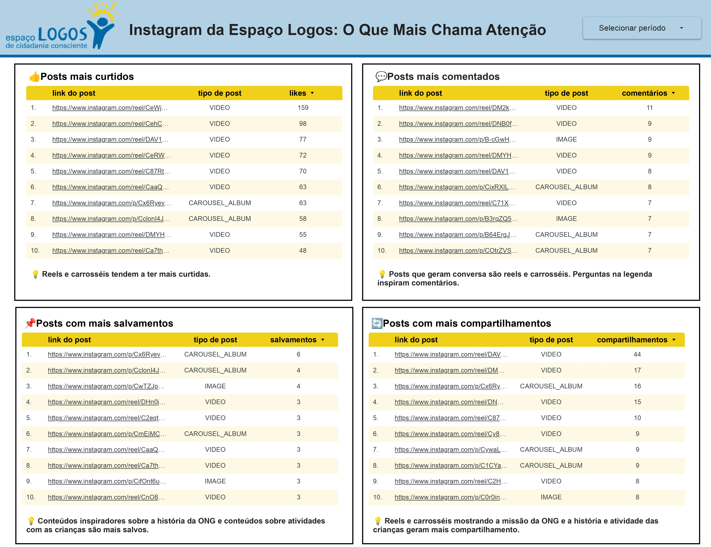
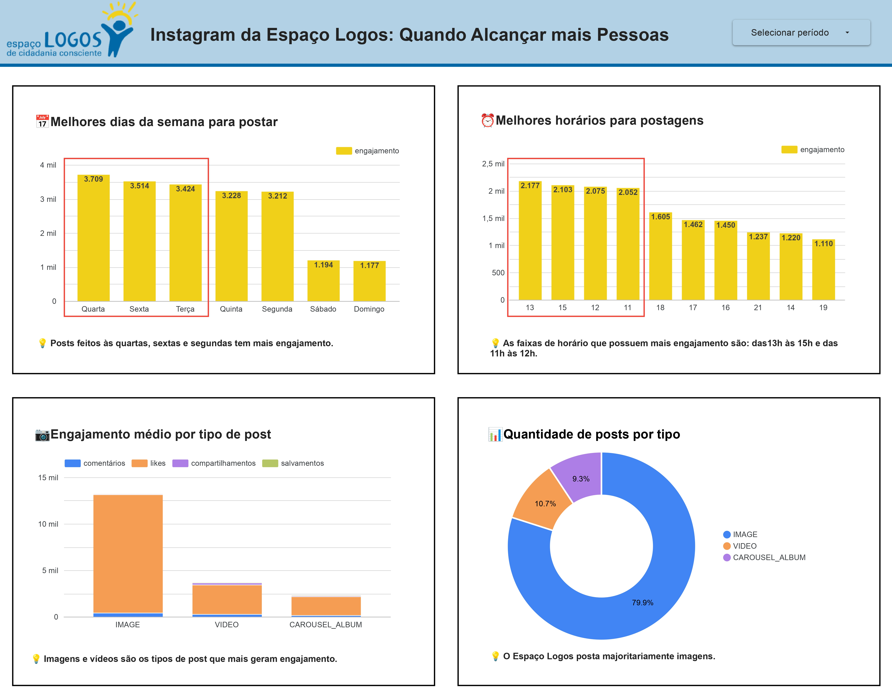

# Pipeline de Dados da Meta para Análise

Projeto desenvolvido para a ONG **Espaço Logos de Cidadania Consciente**, uma organização que promove projetos educativos, culturais e esportivos para crianças e jovens.  
Este repositório contém um ETL que coleta métricas do Instagram da ONG via **Instagram Graph API (Meta)**, salva os dados brutos no **Google Sheets** e alimenta dashboards no **Looker**, tudo automatizado com **GitHub Actions**.

---

## Sobre o Espaço Logos

O Espaço Logos de Cidadania Consciente atua na região da Tijuca (Rio de Janeiro) oferecendo oficinas de educação, cultura e esporte para crianças e jovens em situação de vulnerabilidade, com o objetivo de promover cidadania, cultura e protagonismo juvenil. [Clique aqui](https://espacologos.org.br/) para mais informações.

---

## Funcionamento do Projeto

```
Instagram Graph API ──► Python (ETL) ──► Google Sheets (aba raw) ──► Looker Studio
                              ▲
                       GitHub Actions (cron semanal + disparo manual)
```

1. **Coleta de Dados**
   - Usa a **Instagram Graph API (v19.0)** no endpoint `/{INSTAGRAM_USER_ID}/media` para buscar todas as mídias do perfil.
   - Campos coletados: `id`, `caption`, `media_type`, `timestamp`, `permalink`, `like_count`, `comments_count`.
   - A resposta é paginada (`limit=100`): o script segue o cursor `paging.next` até esgotar as páginas.

2. **Batch de Insights**
   - `saved` e `shares` não vêm na resposta principal e exigem chamadas ao endpoint `/{media_id}/insights?metric=saved,shares`.
   - Para evitar uma requisição por post, o script usa a **Batch API** da Graph API, com até **50 IDs por requisição** (`POST` com o array `batch`).

3. **Armazenamento Raw**
   - Os dados são carregados em um `DataFrame` (pandas), o `timestamp` é formatado como `YYYY-MM-DD HH:MM:SS` e tudo é gravado na aba `raw` do Google Sheets via `gspread`.
   - A aba é limpa (`sheet.clear()`) e reescrita a cada execução (estratégia *full refresh*).

4. **Automação**
   - O **GitHub Actions** executa o script todo domingo às 00:00 UTC (`cron: '0 0 * * 0'`).
   - O gatilho `workflow_dispatch` permite execução manual quando é preciso atualizar os dados fora do agendamento.

5. **Visualização**
   - A aba `raw` é a fonte de dados do dashboard no Looker Studio.

---

## Decisões de Arquitetura
 
| Decisão | Escolha | Por quê | Trade-off |
| :--- | :--- | :--- | :--- |
| **Coleta** | Instagram Graph API (oficial) em vez de scraping | A gestora já tinha acesso ao token via Meta Business. A API é estável e não quebra com mudanças de layout. | Depende de token e de permissões da Meta. |
| **Insights** | Batch API (50 IDs por chamada) | Reduz o número de requisições e o tempo de execução. | Documentação extensa e pouco clara sobre campos, endpoints e permissões; exigiu bastante tentativa e erro. |
| **Armazenamento** | Google Sheets em vez de BigQuery | Poucas publicações, uma única usuária e necessidade de simplicidade. Integra direto com o Looker Studio e a própria gestora pode consultar a base. | Não escala para grandes volumes; BigQuery seria a escolha para mais dados ou uma equipe técnica. |
| **Carga** | Full refresh da aba `raw` | Simples e suficiente para o volume do perfil; evita lógica de deduplicação e garante métricas atualizadas de posts antigos. | Reescreve todos os dados a cada execução. |
| **Orquestração** | GitHub Actions (cron + `workflow_dispatch`) | Sem infraestrutura própria e sem custo; execução manual quando necessário. | Agendamento em UTC e execução limitada pelos recursos do runner. |
| **Segredos** | Variáveis de ambiente / GitHub Secrets | Seguro em repositório open source. | — |
| **Token** | Renovação manual a cada 60 dias | A renovação automática estava planejada, mas ficou de fora por limitação de tempo. | Risco de o pipeline falhar se o token expirar sem renovação. |
 
---
 
## Visualização de Dados com o Looker Studio 

O dashboard foi pensado para uma pessoa sem perfil técnico: cada visualização responde a uma pergunta específica e traz um insight em linguagem simples. Em vez de valores absolutos, usa **médias por publicação**, para evitar distorções causadas pela concentração de posts em determinados formatos, dias e horários. Tem duas páginas.




## Página 1 – O Que Mais Chama Atenção

Explica o que aconteceu.
 
- **Cards:** quantidade de posts (1.340), engajamento médio (14,81), melhor formato (Vídeo, 26,15) e maior oportunidade (Imagem, 12,78).
- **Gráfico de dispersão:** quantidade de posts × engajamento médio por tipo de mídia.
- **O que explica o engajamento?** Seis tabelas:
  - Quantidade de posts por tipo
  - Engajamento médio por post (curtidas, comentários, compartilhamentos e salvamentos)
  - Posts mais curtidos
  - Posts mais comentados
  - Média de salvamentos
  - Média de compartilhamentos

**Achado principal:** em valores absolutos, imagens parecem o formato de maior sucesso porque dominam o calendário. Normalizando por engajamento médio por publicação, a leitura se inverte: vídeos, com apenas 11% dos posts, têm o melhor desempenho.

## Página 2 – Quando Alcançar Mais Pessoas

Responde o que fazer com os dados.
 
- **Melhores dias:** engajamento médio por dia da semana (terça 15,95, quinta 15,02 e quarta 14,99 lideram).
- **Melhores horários:** engajamento médio por faixa de horário (22h e 18h aparecem entre os melhores).
- **Recomendações priorizadas:**
  1. Diversificar formatos, aumentando gradualmente a participação de vídeos.
  2. Priorizar terças, quartas e quintas.
  3. Publicar preferencialmente entre 18h e 22h.
- **Hipóteses para validar:**
  1. Aumentar vídeos de 11% para 20% elevará o engajamento médio.
  2. Carrosséis educativos aumentarão os salvamentos.
  3. Postagens entre 18h e 22h terão desempenho superior às demais.

## Insights Gerais

+ **Vídeos têm o melhor desempenho médio** em curtidas, comentários e compartilhamentos, apesar de representarem apenas 11% das publicações.
+ **Carrosséis lideram em salvamentos** e são o segundo formato em engajamento, sobretudo com conteúdos sobre a história da ONG e as atividades com as crianças.
+ **Imagens concentram quase 80% dos posts** e têm o menor engajamento médio: é a maior oportunidade de melhoria do calendário editorial.
+ **Terças, quartas e quintas** têm os maiores engajamentos médios, assim como o período noturno.


---

## Ferramentas Utilizadas

| Python | Google Sheets | Looker | GitHub Actions |
| :----: | :-----------: | :----: | :------------: |
| <a href="https://www.python.org/" target="_blank"></a> | <a href="https://www.google.com/sheets/about/" target="_blank"></a> | <a href="https://looker.com/" target="_blank"></a> | <a href="https://github.com/features/actions" target="_blank"></a> |
